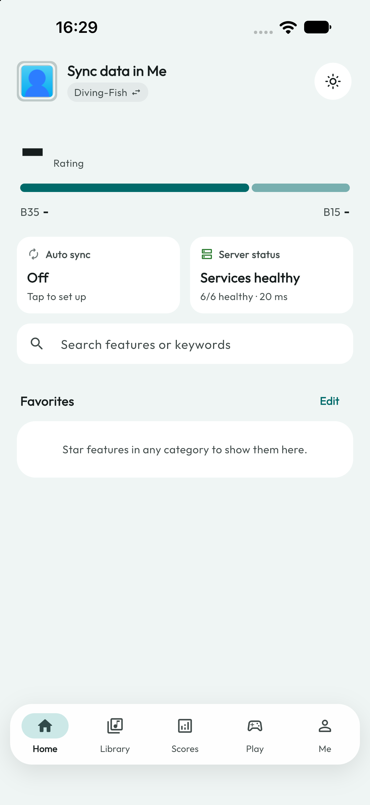
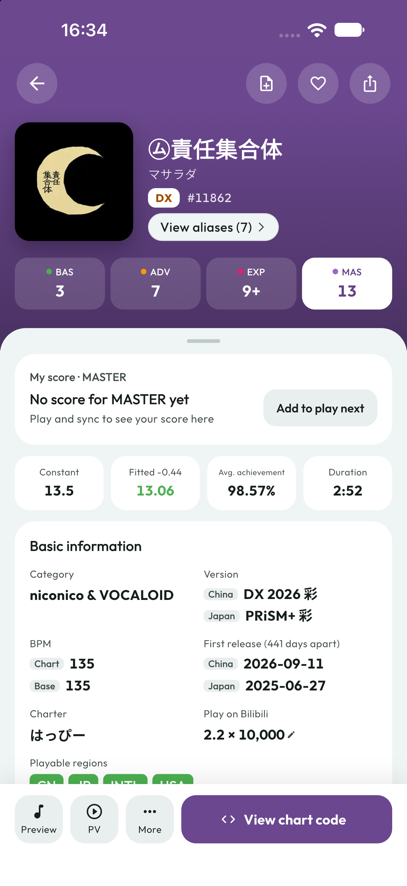
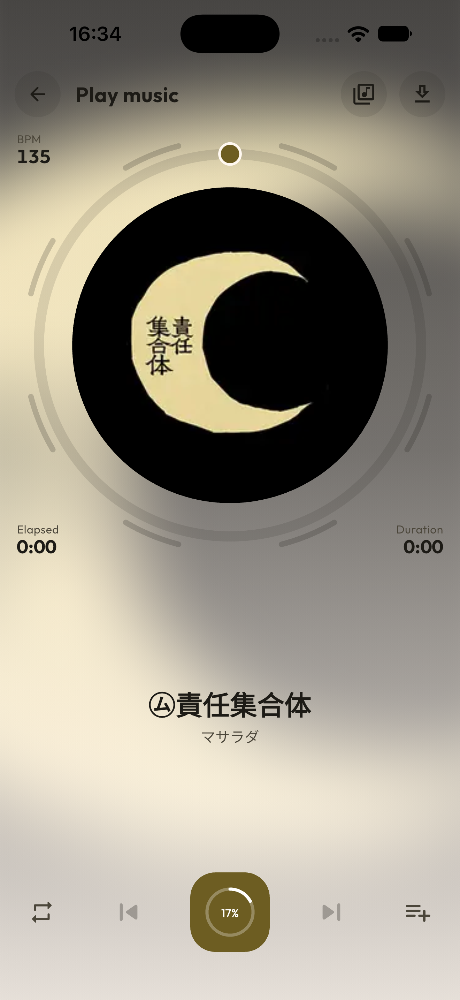
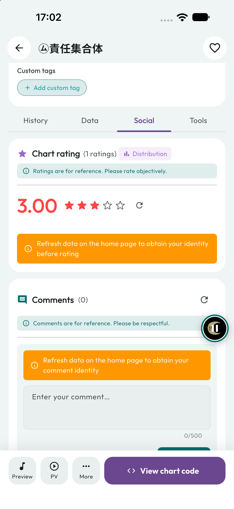

# ChiffonMai

  
  
  
  
  
  

[简体中文](README.md) · English — this translation may lag behind the Chinese README and the in-app copy.

ChiffonMai is a community-made, **unofficial** mobile toolbox for players of the arcade rhythm game *maimai DX*. It puts song lookup, scores and Best50, Rating and achievement-rate calculators, chart preview, recommendations, guessing games, arcade maps and score sync into one app. It is free, ad-free, ships no analytics SDK, does no cross-app tracking, and most features work without signing in.

| Download | Docs (zh) | FAQ / Support | Community |
| --- | --- | --- | --- |
| [App Store](https://apps.apple.com/cn/app/chiffonmai/id6832199686) · [Android APK](https://wward.lanzouw.com/chiffonmai) | [Guide](wiki/Home.md) · [Feature list](wiki/Features.md) | [FAQ](https://chiffonmai.cloud/#faq) · [Support](https://chiffonmai.cloud/support/) | [QQ group](https://qm.qq.com/q/bNUUN3aiaI) 291826702 |

  
  
  
  

## Highlights

- **Library and charts**: search by title, alias, artist, charter, version, type, difficulty and tags; song details with chart constants, version and release dates; chart code with syntax highlight; chart playback with metronome; cover and result-screen recognition; favorites, play queue, random picker, version comparison, update calendar and collectibles. Library and chart data come from AWMC by default.
- **Scores and Rating**: full records and filters, Best50 family (fitting, per-tag, ideal, custom), Rating and achievement-rate calculators with reverse calculation, history, friend comparison, rating/achievement leaderboards, plate progress, dan table, KALEIDXSCOPE, and image export.
- **Recommendations and daily tools**: tag / target Rating / constant-range recommendations, daily and gain recommendations, attendance wheel, portable player, song download, national and global arcade maps.
- **Guessing games**: solo modes (blank, alias, initials, partial/blurred/pixel/flash/puzzle cover, audio clip, reversed, pitch-shifted, chart snippet) and multiplayer rooms.
- **Sync and system**: account switching and authorization, import credentials, single-platform / multi-platform / scheduled sync (AWMC by default; Diving-Fish and LuoXue remain switchable), cache management, backup, announcements, widgets, in-app updates, themes and multilingual UI (zh-Hans, zh-Hant, en, ja).

## FAQ

- **Do I need an account?** No. Only personal score queries, sync and community features require an account on the matching service.
- **Which data sources are supported?** AWMC by default (library, charts and covers; score sync via AWMC NET); Diving-Fish and LuoXue stay available as switchable alternatives. Single-platform, multi-platform and scheduled sync are available.
- **Which chart package format is used?** `.adx` for AstroDX (a folder named after the song inside) and `.zip` for the generic flat package.
- **Can favorites move between devices?** Yes — as a versioned JSON exchange file (default extension `.cmf`, configurable), validated by content and imported as merge or replace.
- **Where is the iOS build?** The release version comes from the App Store; betas come via TestFlight.
- **Is this official?** No. ChiffonMai is a third-party tool, not affiliated with SEGA.

## Privacy

The maintainer is **ChiffonOwO**. Read the full [Privacy Policy](assets/legal/privacy_policy.en.md) and [User Agreement](assets/legal/user_agreement.en.md); both are bundled for offline reading and available online at [chiffonmai.cloud/privacy](https://chiffonmai.cloud/privacy).

- On first launch you must accept the agreement and privacy policy; only the accepted version, time and guardian confirmation are stored locally.
- Tokens are kept in the system secure storage; no plaintext passwords.
- Only feature-specific data leaves the device: result-screen photos and tokens during OCR, comments/ratings/nicknames/scores you submit, and library/Bilibili requests. Search history, favorites and preferences stay local.
- Delete account: *Me → Delete account* clears local account data, credentials, caches and scheduled-sync tasks, and best-effort deletes server-side comments, ratings and ranking entries. Third-party accounts are untouched. Or email chiffonowo@foxmail.com (usually handled within 15 working days).

## Contributing

Use the [bug report](https://github.com/ChiffonMai-Labs/ChiffonMai/issues/new?template=bug_report.yml) or [feature request](https://github.com/ChiffonMai-Labs/ChiffonMai/issues/new?template=feature_request.yml) template and include app version, device model and reproduction steps; mask accounts, tokens and login QR codes. For vulnerabilities or leaked tokens, email chiffonowo@foxmail.com with `[Security]` in the subject before opening a public issue.

Code contributions: open an issue first, work on a branch, keep `flutter analyze --no-pub` at zero errors, run `flutter build apk --release` for `android/` changes, and run `flutter gen-l10n` after ARB edits. See [AGENTS.md](AGENTS.md) for the full conventions (Chinese).

## Credits, license

Creator and community credits are listed in the [Chinese README](README.md#特别致谢), together with data sources (AWMC as the default source, with switchable Diving-Fish and LuoXue; DXRating.net still supplies tags and chart constants during the transition) and open-source components.

Project code is [MIT licensed](LICENSE). Bundled third-party components, fonts and data keep their own licenses — see [simai_flutter MIT](assets/legal/simai_flutter_MIT.txt), [third-party notices](assets/legal/simai_flutter_THIRD_PARTY_NOTICES.md) and [Outfit OFL](assets/legal/outfit_OFL.txt).

ChiffonMai is not affiliated with SEGA. Game names, trademarks, artwork, audio and charts belong to their respective owners. APP registration: 津ICP备2024015256号-3A.
