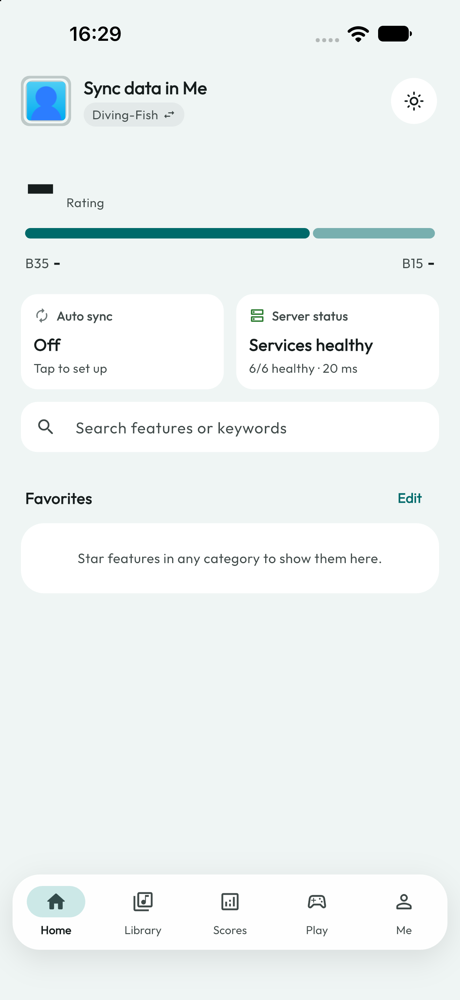
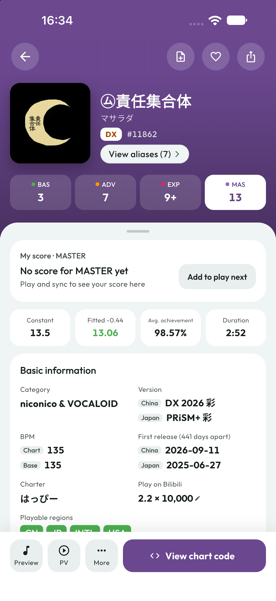
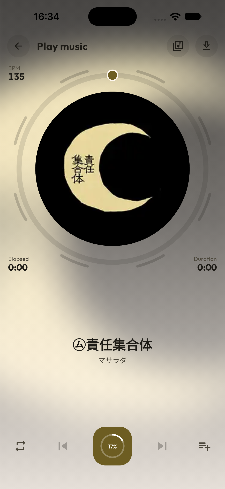
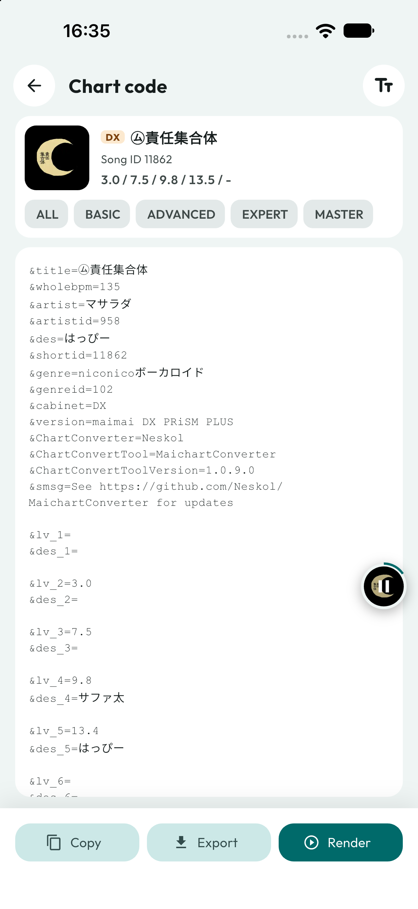
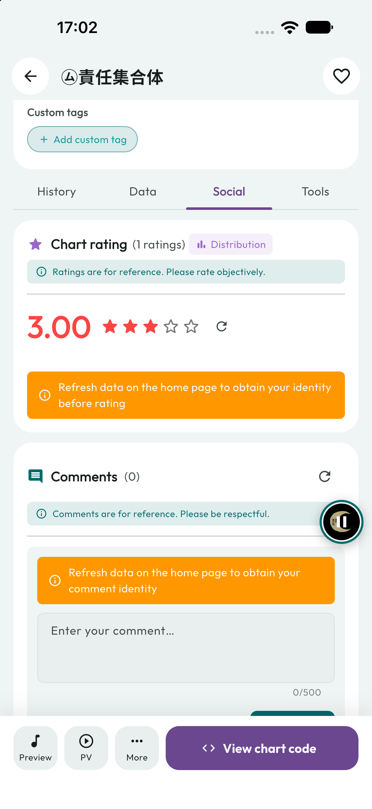

# ChiffonMai


<div align="center">
  <a href="https://apps.apple.com/cn/app/chiffonmai/id6832199686"></a>
  
  
  
  
  <a href="https://github.com/ChiffonMai-Labs/ChiffonMai/actions/workflows/build_ios.yml"></a>
</div>

ChiffonMai 是面向街机音游《舞萌 DX》玩家的**第三方非官方**移动端工具箱，把查曲、成绩与 Best50、Rating 与达成率计算、谱面预览、曲目推荐、猜歌、机厅地图和成绩同步集中在一个 App 里。免费、无广告、不接入统计 SDK、不做跨 App 追踪，多数功能无需登录即可使用。

项目由社区共同维护，欢迎反馈问题、提出建议，也欢迎喜欢这个项目的朋友支持开发。

| 下载 | 使用指南（2.9.0） | 完整功能目录 | FAQ / 支持 | 交流群 |
| --- | --- | --- | --- | --- |
| [App Store](https://apps.apple.com/cn/app/chiffonmai/id6832199686) · [Android APK](https://wward.lanzouw.com/chiffonmai) | [wiki/Home.md](wiki/Home.md) | [wiki/Features.md](wiki/Features.md) | [常见问题](#常见问题) · [支持页](https://chiffonmai.cloud/support/) | [QQ 群](https://qm.qq.com/q/bNUUN3aiaI) 291826702 |

简体中文 · [English](README.en.md)

<div align="center">
  <table>
    <tr>
      <td></td>
      <td></td>
      <td></td>
      <td></td>
      <td></td>
    </tr>
  </table>
  界面截图（iPhone 模拟器，非真机） · [完整 11 张与拍摄说明](app_store_submission/screenshots/README.md) · 3.0 之前的旧界面见 [showImg/](showImg)
</div>

<details>
<summary>目录</summary>

- [当前版本与导航](#当前版本与导航)
- [功能一览](#功能一览)
- [下载和安装](#下载和安装)
- [常见问题](#常见问题)
- [数据来源](#数据来源)
- [账号和隐私](#账号和隐私)
- [开源和参与](#开源和参与)
- [支持开发](#支持开发)
- [特别致谢](#特别致谢)
- [免责声明](#免责声明)
- [许可证](#许可证)

</details>

# 你好! Apple App Store!

我们已经正式支持在 App Store 直接下载 ChiffonMai!

### [点击跳转](https://apps.apple.com/cn/app/chiffonmai/id6832199686)

## 当前版本与导航

当前源码版本为 **3.1.0+61**（上一正式版更新说明见 [v3.0.3](docs/release-notes-3.0.3.md)）。3.0.0 完成了全 App 的界面重做，底部导航为 **首页、曲库、成绩、游玩、我的** 五个标签；「游玩」内分为出勤和休闲。首页「常用」即收藏列表，可拖动排序，并带自动同步和服务器状态小组件。

- **多语言**：界面、服务提示和系统通知支持简体中文、繁体中文、英语、日语，默认跟随系统；歌曲资料、服务端原文和用户内容保持原文。用户协议和隐私政策另有四语版本，随安装包离线可读。
- **绑定与授权管理**：maimai Score Hub、水鱼登录与授权、落雪授权、AWMC NET 账号和机台身份集中在一个入口，按钮下方的状态标签即时更新。
- **成绩导入凭据**：集中管理水鱼 ImportToken、落雪个人 API 密钥和 AWMC NET 成绩导入 Token，并显示各自是否已设置。
- **删除账号**：清除本机账号、登录凭据、成绩缓存与自动同步任务，并尽力删除服务端的评论、评分和排行记录；第三方平台账号不受影响。
- **评论举报与屏蔽**：歌曲详情可举报评论，也可按评论者屏蔽；屏蔽列表在系统设置里管理。
- **社区装扮与机台装扮**：设置社区头像、编排旅行伙伴与搭档，也可扫码读取机台当前的装扮。
- **拉取成绩并更新数据**：拉取所选账号的成绩并重算 Best50，同时更新曲目、定数与标签（原「刷新数据」）。
- **同步**：单平台、多端与自动同步；快速同步复用已绑定的机台身份，三个数据源共用。同步对话框统一为分区布局。
- **自定义标签**：自定义名称、颜色和谱面，接入乐曲查询的标签筛选、谱面详情、Best50 / 收藏夹标签统计和个性化 Best50。
- **App 内更新**：Android 可在 App 内下载并校验安装包，可选线路；测试功能「自动安装更新」需手动开启。
- **外观**：经典悬浮、液态玻璃、伸缩胶囊三种导航样式；自定义背景图可裁剪并自动取色，支持主题色、深色 / 纯黑模式与沉浸式状态栏。
- **桌面小组件**：Android 提供 Rating、状态及中、大尺寸四种小组件。
- **备份**：v3 JSON 包含用户偏好、账号资料、收藏、笔记、自定义标签、猜歌统计、成绩／Rating 历史、自定义背景与本地谱面包归档；兼容旧备份。登录凭据、个人 key、自动同步身份及可重新下载的缓存不导出。
- **诊断**：可从「我的 → 运行诊断 → 打印日志」导出日志；Android 上次崩溃后会在启动时自动导出日志并提示。

完整功能目录与操作说明见仓库内文档：[使用指南](wiki/Home.md)（对应源码 2.9.0 时期，3.0.x 的变化以下方功能一览和更新说明为准）、[完整功能目录](wiki/Features.md)、[开发者指南](wiki/Developer-Guide.md)。此仓库仅追踪 Flutter 客户端与相关文档；生产服务代码、凭据、数据及运维资料不纳入仓库。

## 功能一览

### 曲库、歌曲和谱面

- **乐曲查询**：按歌名、别名、艺术家、谱师、版本、类型、难度和标签（含自定义标签）筛选歌曲。
- **非国服乐曲查询**：单独搜索和筛选非国服曲库的曲目与谱面。
- **自定义标签**：自定义标签名称、颜色和包含的谱面，并在歌曲详情页直接为当前谱面打标签。
- **搜索历史**：保留最近使用过的搜索内容，方便重复查找。
- **歌曲详情**：查看曲绘、艺术家、歌曲类型（ST、DX、UTAGE）、各难度谱面、定数、谱面信息、定数历史和国服 / 日服版本与上线日期；可在设置里选择默认打开的难度，并按歌曲记住上次浏览的难度。
- **歌曲 PV**：在 App 内播放歌曲 PV，支持缓存、横屏全屏和按歌曲保存音频延迟。
- **谱面代码**：查看、复制和导出谱面代码，可切换默认字体与 Inconsolata，并为 `inote` 开启音符语法高亮。
- **谱面播放**：在歌曲详情中预览谱面；节奏轨随音符滚动，显示当前 BPM、同押与细分时值，带节拍器和可高亮的保护套。
- **曲绘识别**：使用图片或相机识别歌曲曲绘。
- **结算画面识别**：从机台结算画面中识别歌曲和成绩。
- **收藏夹备份与恢复**：导入或导出收藏夹数据，便于换设备或重装应用后恢复。
- **版本对照**：按版本查看曲目，了解日服和国服的收录差异。
- **国服更新对照**：查看日服已经上线、国服尚未上线的曲目。
- **更新日历**：按月查看国服每次更新上线的歌曲和谱面。
- **定数分布**：查看自己成绩或曲库中谱面的定数分布。
- **收藏品查询**：查询头像、姓名框、旅行伙伴、搭档等收藏品。

### 成绩、Rating 和排行榜

- **成绩查询**：浏览完整游玩记录，按歌曲、难度、等级、版本、成绩和其他条件筛选，也支持曲库搜索。
- **牌子进度**：查看各版本目标牌子和当前完成进度。
- **进度图片导出**：将牌子进度、个性化成绩和 Best50 系列整理为图片，方便保存或分享。
- **个性化成绩查询**：按等级、谱师和其他条件集中查看成绩。
- **单曲 Rating 计算**：根据歌曲定数和达成率计算单曲 Rating。
- **达成率计算**：根据 TAP、HOLD、SLIDE、TOUCH、BREAK 等判定详情计算达成率。
- **达成率反推**：根据目标达成率反推出需要达到的判定情况。
- **Best50**：查看当前 Best35 和 Best15，并了解各歌曲对总 Rating 的贡献。
- **拟合 Best50**：估算潜在 Rating 上限，辅助制定练习目标。
- **个性化 Best50**：按标签筛选和查看个人 Best50。
- **个性化拟合 Best50**：按标签分析拟合 Rating 上限。
- **理想 Best50**：根据理想成绩估算 Best50，宴会场等不计入 Rating 的歌曲不会被算入有效 Rating。
- **自定义 Best50**：手动填写 50 张成绩卡片，制作示意成绩图。
- **Rating 历史与成绩提升历史**：按指定日期区间查看记录。
- **Rating 排行榜**：查看玩家 Rating 排名，并切换不同排行类型。
- **拟合总 Rating 排行榜**：比较拟合总 Rating 与官方 Best50 的差值。
- **平均达成率排行榜**：按全量成绩的平均达成率查看排行。
- **平均 DX 分数达成率排行榜**：按全量成绩的平均 DX 得分达成率查看排行。
- **特殊排行榜**：浏览各类玩家数据排行和国服歌曲时长榜，可切换正向和反向排行。
- **好友对比**：对比自己与好友的成绩差异和 Rating 情况。
- **段位表**：查看段位挑战内容，并记录每个段位的未挑战、不合格、合格或赤合格状态以及总达成率。

### 社区与互动

- **社区装扮**：「我的」页顶部可设置社区头像并编排旅行伙伴与搭档，已公开的排行榜玩家简要信息也能展示其旅行伙伴与搭档。
- **最近评论与最近评分**：集中查看社区最近的评论和评分，可进入对应歌曲详情。
- **评论举报与屏蔽**：在歌曲详情举报评论、按评论者屏蔽，屏蔽列表在系统设置里管理。

### 歌曲推荐和日常辅助

- **基于标签推荐**：根据已游玩谱面的标签推荐可能感兴趣的曲目。
- **基于目标 Rating 推荐**：寻找适合当前目标和 Rating 区间的谱面。
- **基于定数区间推荐**：按定数范围挑选歌曲。
- **每日推荐**：每天获取一组推荐歌曲，决定今天练什么。
- **吃分推荐**：由 AWMC 提供算法支持，按缓存记录给出专属吃分歌单。
- **出勤转盘**：使用等分转盘决定本次出勤或不出勤；区域按出勤、不出勤交替排列，可调整区域数量并记住设置。
- **随机乐曲**：按筛选条件随机抽取歌曲，可用数字步进器选择抽取数量；抽取时卡片轮播，手动点击“停！”揭晓结果。
- **收藏夹**：创建和管理收藏夹，整理想练习或想游玩的谱面。
- **下次想玩**：把歌曲加入待游玩队列，集中查看下一次想挑战的曲目。
- **自定义谱面播放**：导入本地谱面包并播放。
- **随身听**：后台播放歌曲，支持通知栏控制、播放队列、前后曲预览和滑动切歌。
- **歌曲下载**：将随身听中的歌曲保存为歌名命名的 MP3，并写入公开访问目录，方便在文件管理器中找到。
- **KALEIDXSCOPE**：查看青门、白门、黄门、红门和紫门等时间段，了解当前日期进度、对应难度和血量信息。
- **全国音游地图**：查看国内音游机厅信息。
- **全球音游街机地图**：查看 NearCade 的全球机厅数据，支持搜索、筛选、地图缩放，以及机厅点的聚合和展开。

### 猜歌游戏

- **单人猜歌游戏设置**：统一管理各模式的规则与偏好，修改自动保存。
- **无提示猜歌**：凭记忆直接挑战曲库。
- **部分曲绘猜歌**：从一小块曲绘猜歌曲。
- **模糊曲绘猜歌**：根据模糊处理后的曲绘猜歌曲。
- **歌曲片段猜歌**：根据截取的音源片段猜歌曲。
- **倒放音频与变速变调猜歌**：根据处理后的音源片段猜歌曲。
- **曲绘快闪与曲绘拼图**：根据短暂显示或逐步揭示的曲绘猜歌。
- **像素曲绘猜歌**：根据像素马赛克的色块与轮廓猜歌，可调马赛克强度。
- **谱面片段猜歌**：观看无声谱面片段，按难度随机池挑战。
- **别名猜歌**：使用歌曲别名挑战熟悉度。
- **舞萌开字母**：根据歌曲首字母猜歌。
- **多人猜歌游戏**：和朋友一起进行猜歌对战。

### 数据同步、系统和开发支持

- **账号注册引导**：集中提供水鱼、落雪注册入口和 AWMC NET 档案创建引导。
- **切换账号**：切换数据源与玩家信息，使用本地缓存。
- **拉取成绩并更新数据**：拉取所选账号的成绩并重算 Best50，同时更新曲目、定数与标签；高级模式可按数据类型强制重新下载并测试接口连通性。
- **刷新机台游玩次数**：单独读取当前账号的 PC 数，不附带成绩同步。
- **同步机台装扮**：扫码或粘贴舞萌登录二维码，读取机台当前选中的头像、姓名框、背景、称号、旅行伙伴和搭档。
- **缓存管理**：查看、清理音源、PV 与 maidata，并重新拉取基础量 maidata。
- **同步成绩到水鱼**：通过机台二维码或导入流程同步成绩到水鱼查分器。
- **同步成绩到落雪**：将本地成绩同步到落雪咖啡屋。
- **同步成绩到 AWMC NET**：通过二维码等方式同步成绩到 AWMC NET。
- **同步成绩到多端**：一次同步到多个支持的查分服务。
- **自动同步**：每天北京时间 0 点和 12 点自动快速同步，任务需在七天内手动续期。
- **绑定与授权管理**：登录 maimai Score Hub、登录 / 登出水鱼并管理水鱼授权、授权落雪、绑定 AWMC NET 账号和机台身份。
- **删除账号**：清除本机账号数据与服务端记录，见「账号和隐私」。
- **成绩导入凭据**：管理水鱼 ImportToken、落雪个人 API 密钥和 AWMC NET 成绩导入 Token。
- **服务器状态**：查看舞萌相关服务的当前状态，数据来源于 isMaiDown by Chongxi。
- **公告中心**：浏览公告历史并打开公告详情。
- **数据备份**：导入或导出本地用户资料、偏好与用户文件，不包含登录凭据和可重新获取的缓存。
- **加载语录管理**：选择本地语录或云端语录，管理加载页面显示的内容，也可以新增本地语录并上传到云端。
- **打印日志**：将调试日志导出到项目约定的公开可访问目录，便于反馈问题。
- **检查更新**：检查是否有新版本可用；Android 可在 App 内下载更新，iOS 通过 App Store 更新、Beta 包在 TestFlight 内更新。
- **系统设置**：调整语言、主题色、浅色或深色模式、背景图、交互选项与同步/网关选项。
- **支持开发者**：查看支持方式，并下载赞赏码图片。
- **查看友情链接**：浏览相关项目和社区链接。
- **问题反馈**：打开反馈问卷，附带复现步骤和日志更佳。
- **加入 QQ 群**：一键跳转官方交流群。
- **问卷调查**：参与问卷，帮助改进 ChiffonMai。
- **关于 APP**：查看版本信息、备案号、项目介绍、开发者信息、用户协议、隐私政策与完整致谢名单。
- **访问官方网站**：前往 [chiffonmai.cloud](https://chiffonmai.cloud) 查看项目主页。
- **AWMC 机台工具**：游玩次数、机台装扮等 AWMC 机台相关入口按当前版本配置提供，使用时遵循页面提示。

## 下载和安装

当前版本 **3.1.0+61**，上一正式版更新内容见 [v3.0.3 更新说明](docs/release-notes-3.0.3.md)。

### iOS

iOS 正式版通过 App Store 安装和更新：

1. 打开 [App Store 页面](https://apps.apple.com/cn/app/chiffonmai/id6832199686)。
2. 点击获取并安装。
3. 后续在 App Store 的账户页面更新；App 内「检查更新」会打开 TestFlight 邀请页或发布说明。

想提前体验测试版，可通过 [TestFlight 邀请页](https://testflight.apple.com/join/MB5CGtv4) 加入 Beta；Beta 与正式版可并存于 TestFlight / App Store 各自的渠道。

### Android

Android 通过 APK 安装：

1. 前往[下载页面](https://wward.lanzouw.com/chiffonmai)或 [GitHub Releases](https://github.com/ChiffonMai-Labs/ChiffonMai/releases/latest) 获取最新 APK。发布包按 `arm64-v8a`、`armeabi-v7a`、`x86_64` 分架构：绝大多数手机选 `arm64-v8a`，`x86_64` 主要供模拟器，`armeabi-v7a` 仅限旧设备。
2. 根据系统提示允许安装来自浏览器或文件管理器的应用。
3. 安装完成后打开 ChiffonMai。

已安装的用户可在 App 内「检查更新」下载并校验同一构建号的安装包，不必回下载页。如果系统提示应用来源不明，请确认 APK 来自项目提供的下载页面，再决定是否继续安装。

### 从源码构建

需要 Flutter 3.47+（以 `pubspec.lock` 的 `sdks` 约束为准）、Dart 3.13+、JDK 17、Gradle 8.14 和 Android platform 35 / build-tools 35 / NDK 28.2.13676358；Android 最低 7.0（API 24），iOS 最低 13.0。依赖全部锁定，不要随手升级。iOS CI 目前仍固定 Flutter 3.41.7，发布前需要与锁文件同步。

```bash
flutter pub get
flutter run
flutter build apk --release --dart-define="CLIENT_API_KEY=<客户端网关 Key>"
```

- release 构建必须提供 `android/key.properties` 与正式 keystore，缺了会直接构建失败，绝不回退 debug 签名；两者都不入库，务必离线备份。
- `CLIENT_API_KEY` 是编译期 `--dart-define` 注入的客户端网关 Key：本地 `flutter run` 调试可以省略，release 构建与 iOS CI 必须提供（未配置 secret 时 CI 直接失败）。不要把真实 Key 提交进仓库。
- `simai_flutter` 是 `third_party/` 下的定制副本，Flame 锁定 1.37.0，播放页依赖它和竖屏锁定，升级后必须真机回归。
- iOS CI 见 [docs/ios-actions-build.md](docs/ios-actions-build.md)：GitHub Actions 手动或 `v*` 标签触发，产物是**未签名 IPA**，需自签，不能直接进 TestFlight / App Store。
- 开发约定与易错点见 [AGENTS.md](AGENTS.md)（与 [CLAUDE.md](CLAUDE.md) 同文）和 [开发者指南](wiki/Developer-Guide.md)；App Store 评审与提交材料见 [docs/app-store-review-notes.md](docs/app-store-review-notes.md) 与 [app_store_submission/](app_store_submission/README.md)（走查视频与构建产物仅本地生成，不在仓库里）。

## 常见问题

- **必须登录数据源才能使用吗？** 不需要。曲库、歌曲详情、计算器、推荐、随机、谱面播放、地图和多数本地工具无需登录；只有个人成绩查询、同步和社区功能需要对应账号。
- **支持哪些数据源？** 水鱼查分器、落雪咖啡屋和 AWMC NET，可单平台、多端或定时自动同步。
- **导出的谱面包是什么格式？** AstroDX 使用 `.adx`（包内按曲名套一层文件夹），通用谱面包使用 `.zip`（三件套平铺）。
- **收藏夹可以在设备之间转移吗？** 可以。导出为带版本与去重键的 JSON 交换文件（默认后缀 `.cmf`，可自定义），导入按内容校验，支持合并或覆盖。
- **iOS 版在哪里下载？** 正式版走 App Store，测试版走 TestFlight。
- **这是 SEGA 官方应用吗？** 不是，是社区维护的第三方工具。

更多问题见[官网 FAQ](https://chiffonmai.cloud/#faq)。反馈时请附应用版本、机型和复现步骤，并先遮盖账号、Token 与登录二维码。

## 数据来源

为了提供曲库、成绩、谱面、机厅与社区功能，应用会在对应功能中请求以下公开或获得授权的数据服务，包括但不限于：

- [水鱼查分器](https://www.diving-fish.com/maimaidx/prober/)
- [DXRating.net](https://dxrating.net/)
- [落雪咖啡屋](https://maimai.lxns.net/)
- [AWMC NET](https://net.wmc.pub/)
- [Union](https://union.godserver.cn/)
- [Yuri-YuzuChaN/maimaiDX](https://github.com/Yuri-YuzuChaN/maimaiDX)
- [NearCade](https://nearcade.cn/)
- [全国音游地图](https://map.bemanicn.com/)
- [AWMC KALEIDXSCOPE](https://kaleidxscope.awmc.team/)
- [isMaiDown by Chongxi](https://mai.chongxi.us/)（舞萌服务器状态）
- [maimai Score Hub](https://github.com/bakapiano/maimai-score-hub)（账号登录、结算识别与社区接口）
- [高德地图](https://www.amap.com/) 底图与 [哔哩哔哩](https://www.bilibili.com/) 谱面确认 / PV
- 百度翻译（经自家服务端代理，用于界面外文本翻译）

不同功能使用的数据来源不同，数据更新时间也可能不同。排行榜和社区数据仅供参考，请以游戏内实际情况和各服务的最新信息为准。

## 账号和隐私

开发维护者为 **ChiffonOwO**（主开发与 Android 平台的构建，[GitHub](https://github.com/ChiffonOwO) · [哔哩哔哩](https://space.bilibili.com/442305158)）与 **Michaelwucoc**（iOS 平台的构建与维护，[GitHub](https://github.com/Michaelwucoc)）。完整说明见[《隐私政策》](assets/legal/privacy_policy.md)与[《用户协议》](assets/legal/user_agreement.md)，两文随安装包离线可读（[繁体](assets/legal/privacy_policy.zh_Hant.md) / [English](assets/legal/privacy_policy.en.md) / [日本語](assets/legal/privacy_policy.ja.md)），也可在线查看 [chiffonmai.cloud/privacy](https://chiffonmai.cloud/privacy)；App 内路径为「我的 → 关于 APP」。

- 首次启动的引导页需要确认用户协议与隐私政策后才能继续，本机只记录所确认的版本、时间以及是否由监护人确认。
- 不登录也可以使用曲库查询、歌曲详情、计算器、推荐、随机抽歌、谱面播放、地图和多数本地工具。
- 需要登录的同步和成绩查询功能，只会在你主动使用时请求对应服务。
- 登录信息和令牌使用系统安全存储能力保存；应用不保存账号密码明文。
- 会离开设备的数据限于对应功能所需：结算识别时上传的结算照片与令牌、主动发布或上报的评论、评分、昵称、成绩与排行数据，以及曲库 / B 站等接口请求。搜索历史、收藏和页面偏好默认只写本机。
- 删除账号入口为「我的 → 删除账号」：清除本机账号、凭据、成绩缓存与自动同步任务，并尽力删除服务端评论、评分与排行记录；第三方平台账号保留。必要时可邮件联系 [chiffonowo@foxmail.com](mailto:chiffonowo@foxmail.com)，一般 15 个工作日内处理。
- 使用第三方服务时，请同时遵守对应服务的使用规则和隐私政策。

APP 备案号：津ICP备2024015256号-3A

## 开源和参与

项目仓库与联系方式：

- [GitHub](https://github.com/ChiffonMai-Labs/ChiffonMai)
- [Gitee](https://gitee.com/liangyingjun123/ChiffonMai)
- [官方网站](https://chiffonmai.cloud)
- 交流 QQ 群：[291826702](https://qm.qq.com/q/bNUUN3aiaI)
- 邮箱：[chiffonowo@foxmail.com](mailto:chiffonowo@foxmail.com)

欢迎通过 [问题反馈模板](https://github.com/ChiffonMai-Labs/ChiffonMai/issues/new?template=bug_report.yml) 或 [功能提议模板](https://github.com/ChiffonMai-Labs/ChiffonMai/issues/new?template=feature_request.yml) 提交 Issue，附应用版本、机型、复现步骤和相关页面；公开前先遮盖账号、Token、授权码和登录二维码。也可以填写[反馈问卷](https://wj.qq.com/s2/28237817/wmfe/)或加入交流群。

遇到黑屏、布局或性能问题：先复现，尽快回到全屏，在「我的 → 运行诊断 → 打印日志」导出日志，并附手机型号、系统版本、复现步骤、发生时间和截图 / 录屏；小窗、Surface 或 Vulkan 类问题请同时附原始 `adb logcat -v threadtime -b main -b system -b crash`，不要用 AI 摘要代替原始日志。提交前检查日志中是否还有个人信息。

**参与开发**：先开 Issue 对齐范围，再从分支提交 PR。改 Dart 后跑 `flutter analyze --no-pub` 保持零 error；改了 `android/` 必须 `flutter build apk --release` 并核对合并清单；改 ARB 后运行 `flutter gen-l10n`；依赖锁定不要随手升级。完整约定见 [AGENTS.md](AGENTS.md)。

**安全披露**：发现漏洞或怀疑令牌、二维码泄露时，请发邮件到 [chiffonowo@foxmail.com](mailto:chiffonowo@foxmail.com)（标题加 `[Security]`），确认前不要先开公开 Issue。

文档索引：[开发者指南](wiki/Developer-Guide.md) · [iOS 构建说明](docs/ios-actions-build.md) · [更新说明](docs/release-notes-3.0.3.md) · [App Store 评审说明](docs/app-store-review-notes.md) · [提交资料包](app_store_submission/README.md)

<a href="https://github.com/ChiffonMai-Labs/ChiffonMai"></a>

<a href="https://github.com/ChiffonMai-Labs/ChiffonMai/graphs/contributors"></a>

如果 ChiffonMai 帮到你，欢迎点一个 Star。

## 支持开发

ChiffonMai 免费、无广告、不接入统计 SDK。赞助用于服务器开销与持续开发，不影响功能使用。

- [爱发电](https://ifdian.net/a/chiffonmai/plan)
- 微信赞赏码：

  

## 特别致谢

感谢所有提供设计建议、测试数据、曲库与谱面数据、同步服务、开发支持和捐献支持的朋友。下面名单与应用内“关于”页面共用同一份基准，排名不分先后；仓库版另外补充了部分数据来源、许可证与第三方声明链接。

### 创作与支持

- **Michaelwucoc**：为本项目的开发提供了技术支持和经济支持，为项目的推进提供了极大的帮助。[GitHub](https://github.com/Michaelwucoc)
- **Xn1xUfguF1GiNg**：为本项目提供的背景图和戚风小狐狸（真的非常可爱）。[个人页面](https://huajia.163.com/main/profile/RrwM5xQB)
- **Takanashi Rikkkkkkka**：为本项目的个性化谱面推荐功能提供宝贵设计思路。
- **三由yyyh**：为本项目的页面设计提供了宝贵意见。
- **MYD**：提供了用于测试开发的个人游玩数据。
- **乐观的熊猫**：提议开发 ChiffonMai，为本项目诞生提供最初契机。[bilibili](https://space.bilibili.com/438391224)
- **迪拉熊重度依赖**：为本项目在前端细节与交互体验上提供了诸多宝贵建议。[GitHub](https://github.com/Timome-Sudo)
- **ChiffonMai交流群的全体群友**：为本项目开发提供了诸多宝贵建议和反馈。

### 捐献致谢

- **Pokcet**：感谢对本项目的捐献支持。
- **ListaQwQ**：感谢对本项目的捐献支持。
- **迪拉熊重度依赖**：感谢对本项目的捐献支持。[GitHub](https://github.com/Timome-Sudo)
- **鱼好呆**：感谢对本项目的捐献支持。
- **Rinviolet**：感谢对本项目的捐献支持。[bilibili](https://b23.tv/hIpEBUO)
- **Redapple_one**：感谢对本项目的捐献支持。[个人主页](https://me.redapple.one)
- **苏洛依**：感谢对本项目的捐献支持。
- **Roid**：感谢对本项目的捐献支持。
- **Cartethyia～**：感谢对本项目的捐献支持。
- **阳华**：感谢对本项目的捐献支持。

### 数据与服务

- **水鱼查分器**：提供曲目数据库和玩家游玩记录数据库。[官网](https://www.diving-fish.com/maimaidx/prober/)
- **DXRating.net**：提供定数历史、全局标签和备用曲绘。[官网](https://dxrating.net)
- **AWMC**：提供社区歌曲别名、歌曲详情的谱面标签和曲绘。[谱面预览](https://v.wmc.pub/) · [曲绘与谱面目录](https://download.wmc.pub/)
- **Yuri-YuzuChaN**：提供备用别名数据库。[项目地址](https://github.com/Yuri-YuzuChaN/maimaiDX)
- **落雪咖啡屋**：提供收藏品数据库、歌曲音源支持、曲目数据库和玩家游玩记录数据库。[官网](https://maimai.lxns.net)
- **Neskol**：提供谱面转换支持。[项目地址](https://github.com/Neskol/Maichart-Converts/tree/master)
- **AWMC NET**：提供水鱼查分器同步支持、落雪查分器同步支持和对本项目开发的经济支持。[官网](https://net.wmc.pub/)
- **Bakapiano**：提供水鱼查分器和落雪查分器成绩同步支持。[项目地址](https://github.com/bakapiano/maimai-score-hub)
- **DevinTom**：提供落雪查分器成绩同步支持。[项目地址](https://github.com/k4641321/chusearchsong_flutter/tree/master)
- **Union**：提供曲目数据库。[官网](https://union.godserver.cn/)
- **NearCade**：提供全球机厅相关数据。[官网](https://nearcade.cn/)
- **全国音游地图**：提供国内机厅相关数据。[官网](https://map.bemanicn.com/)
- **AWMC KALEIDXSCOPE**：提供 KALEIDXSCOPE 门数据。[官网](https://kaleidxscope.awmc.team/)
- **mai.chongxi.us**：提供舞萌服务器状态信息（应用当前实际接口）。[服务地址](https://mai.chongxi.us/)
- **SilentBlue.RemyWiki**：提供高清版本图片。[官网](https://silentblue.remywiki.com/Main_Page)
- **simai_flutter · Project Fukakai**：提供谱面解析和播放器，采用 MIT 许可证；谱面引擎部分改编自 maimai-chart-engine（MIT）。[项目地址](https://github.com/Project-Fukakai/simai_flutter) · [许可证](assets/legal/simai_flutter_MIT.txt) · [第三方声明](assets/legal/simai_flutter_THIRD_PARTY_NOTICES.md)

### 设计思路借鉴

- [**EasyMai**](https://github.com/Lista233/EasyMai)：设计思路借鉴。
- [**舞萌猜猜呗之潘一把**](https://github.com/yukineko2233/v0-maimai-wordle)：设计思路借鉴。[在线体验](https://maimai.yukineko2233.top/)
- [**MaiScan Rev**](https://github.com/PojavAnge/MaiScan-Rev)：设计思路借鉴。
- [**中二查歌**](https://github.com/k4641321/chusearchsong_flutter)：设计思路借鉴。
- [**bakapiano/maimai-score-hub**](https://github.com/bakapiano/maimai-score-hub)：设计思路借鉴。
- [**落雪咖啡屋 (@lxns-network/maimai-chart-engine)**](https://github.com/Lxns-Network/maimai-prober-frontend)：街机还原 NOTE 样式与绘制比例参考（MIT）。[第三方声明](assets/legal/simai_flutter_THIRD_PARTY_NOTICES.md)

### 开源组件

App 使用了大量开源软件，完整依赖与版本见 [pubspec.lock](pubspec.lock)，各组件保留其原始许可证。主要组件包括 [Flutter](https://github.com/flutter/flutter)（BSD-3）、[flame](https://github.com/flame-engine/flame)（MIT）、[fl_chart](https://github.com/imaNNeo/fl_chart)（MIT）、[flutter_map](https://github.com/fleaflet/flutter_map)（BSD-3）、[just_audio](https://github.com/ryanheise/just_audio)（MIT）、[audioplayers](https://github.com/bluefireteam/audioplayers)（MIT）、[mobile_scanner](https://github.com/juliansteenbakker/mobile_scanner)（BSD-3）、[video_player](https://github.com/flutter/packages)（BSD-3）、[google_fonts](https://github.com/material-foundation/google-fonts)（BSD-3）与 [font_awesome_flutter](https://github.com/brianegan/font_awesome_flutter)（MIT），以及 [markdown_widget](https://github.com/lipanpan-bin/markdown_widget)、[cached_network_image](https://github.com/Baseflow/flutter_cached_network_image)、[dio](https://github.com/cfug/dio)、[archive](https://github.com/brendan-duncan/archive)、[file_picker](https://github.com/miguelpruivo/flutter_file_picker) 等。

字体：[Outfit](https://fonts.google.com/specimen/Outfit)（SIL OFL 1.1，[许可证全文](assets/legal/outfit_OFL.txt)）与思源黑体 Noto Sans SC（SIL OFL 1.1，[许可证](https://github.com/notofonts/noto-cjk/blob/main/LICENSE)），中文按相同字重回落到 Noto Sans SC。

## 免责声明

ChiffonMai 是社区制作的第三方工具，与 SEGA 没有隶属或官方合作关系。

本项目仅供学习和娱乐使用。游戏名称、商标、曲绘、音频与谱面归各自权利人所有；歌曲、谱面、成绩、排行榜和机厅信息来自相关数据服务，可能存在延迟、缺失或误差，请以游戏内实际情况和各服务的最新信息为准。

## 许可证

本项目源代码使用 [Mozilla Public License 2.0（MPL-2.0）](LICENSE) 开源。

项目的品牌与原创美术资产（包括但不限于 `ChiffonMai` 名称、应用图标 `assets/icon.png`、画师授权或原创的「戚风小狐狸」形象及配套背景素材）**不适用上述开源许可证，保留所有权利（All Rights Reserved）**，未经许可不得用于第三方发行版本或商业用途。

随应用分发的第三方组件、字体与数据不适用项目 MPL-2.0，而按各自的许可证授权：[simai_flutter MIT](assets/legal/simai_flutter_MIT.txt) · [simai_flutter 第三方声明](assets/legal/simai_flutter_THIRD_PARTY_NOTICES.md) · [Outfit SIL OFL 1.1](assets/legal/outfit_OFL.txt)。完整第三方依赖清单以 [pubspec.yaml](pubspec.yaml) / [pubspec.lock](pubspec.lock) 为准。播放器是 [third_party/simai_flutter](third_party/simai_flutter) 下的本地定制副本，目录内自带 `LICENSE` 与 `THIRD_PARTY_NOTICES.md`，修改需遵守上游 MIT 与第三方声明。
